# Showcase

A seed in progress (v0.6.0), played on a local room. Everything below is the
UmamusumeX dashboard (Mods > Archipelago) and the game itself; nothing is
installed in the client.

## In the game

**Only unlocked scenarios can be picked.** This seed has URA Finale (starting
scenario) and Grand Live (received as an item); Unity Cup and Trackblazer stay
hidden until they arrive.

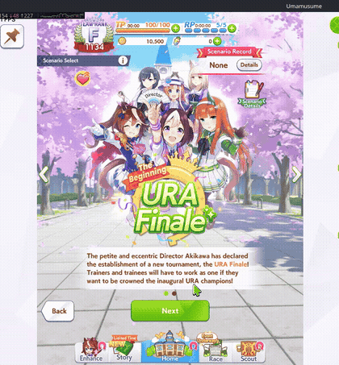

([mp4](media/scenario-select.mp4))

**Each seed starts you with its own random trainees.** Only those, and the
ones you receive as items (here Kitasan Black), can start a career; everyone
else stays unscouted.

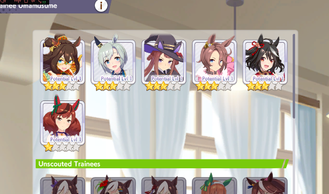

**Items arrive as presents.** Trainees and support cards land in the gift box,
marked with who sent them.

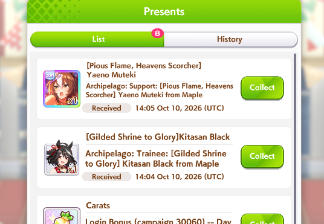

| Trainee, with her outfit | SSR support card |
|---|---|
| 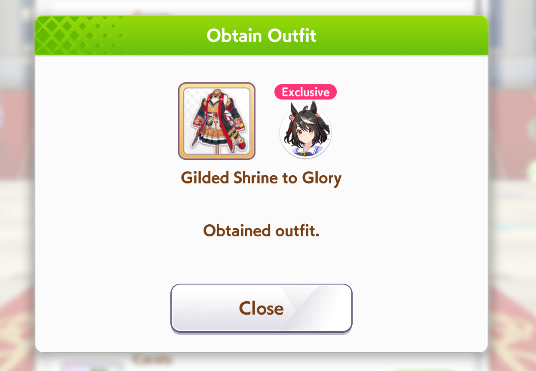 | 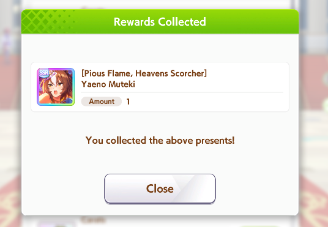 |

**SSR support cards arrive maxed** (limit broken, level 50), ready for the next career.

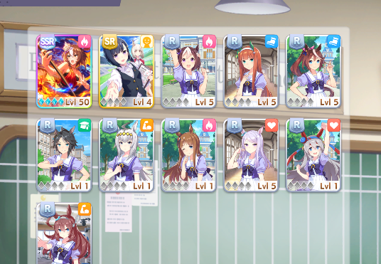

## In the dashboard

The Mods page. Turning Archipelago on sets the other mods aside and brings them
back when it's off.

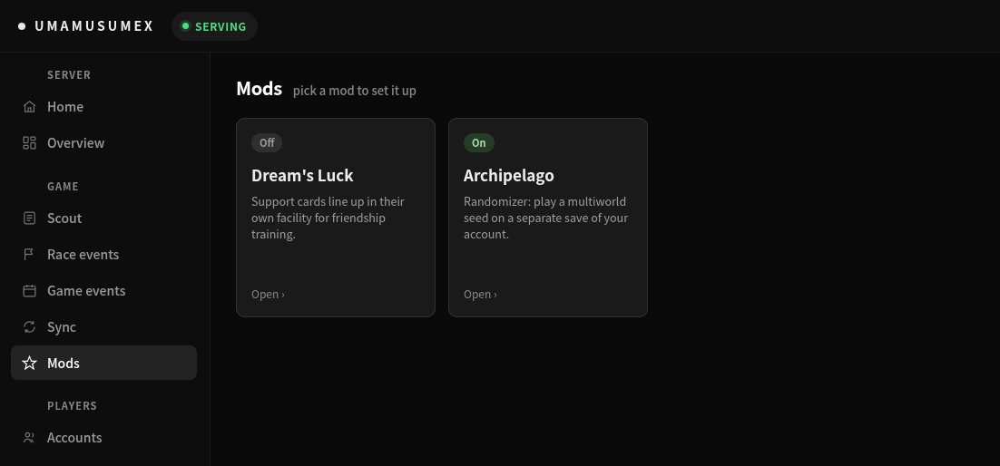

Room settings and the live connection: seed, items received, checks done, the
goal, what's queued for the next career and the latest checks.

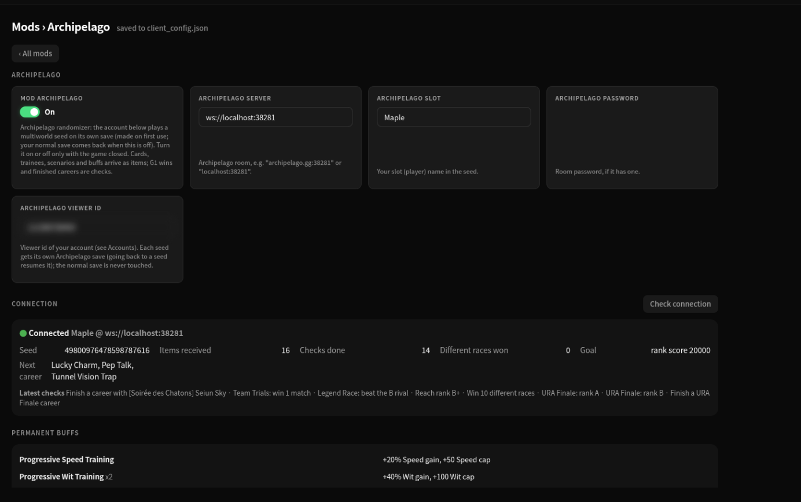

Permanent buffs (stacking, with their total effect), traps and boons for the
current and next career, and hints asked straight from the page.

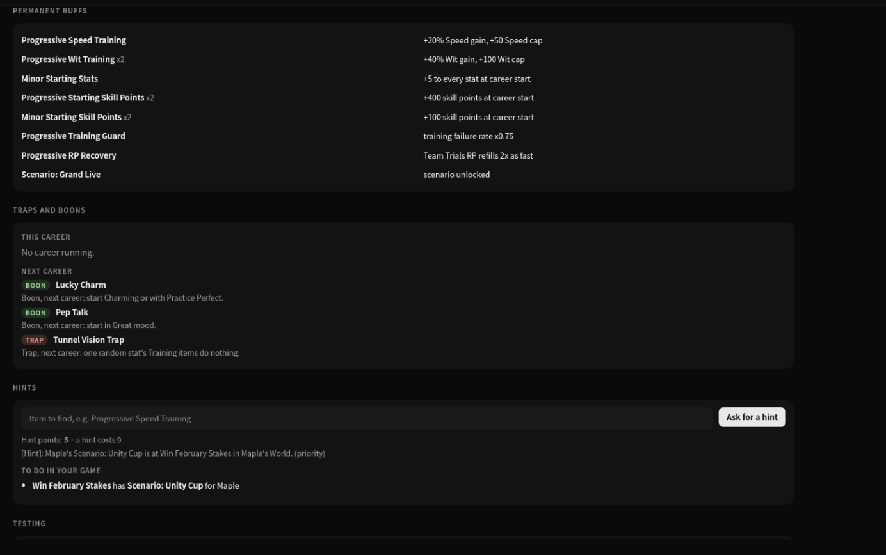

Items sent from your checks and items received, with their class and where they came from.

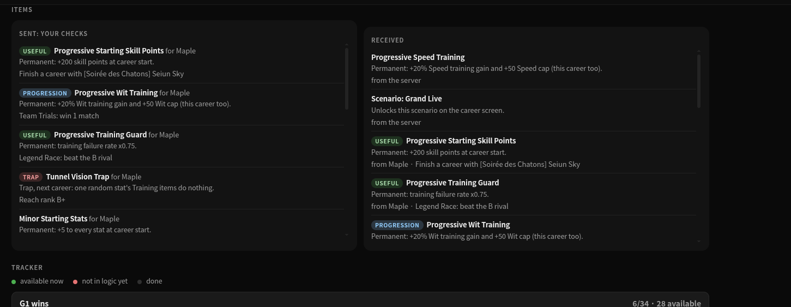

The tracker: every check by group, green when it's in logic now, red when it
still needs items, struck out when done.

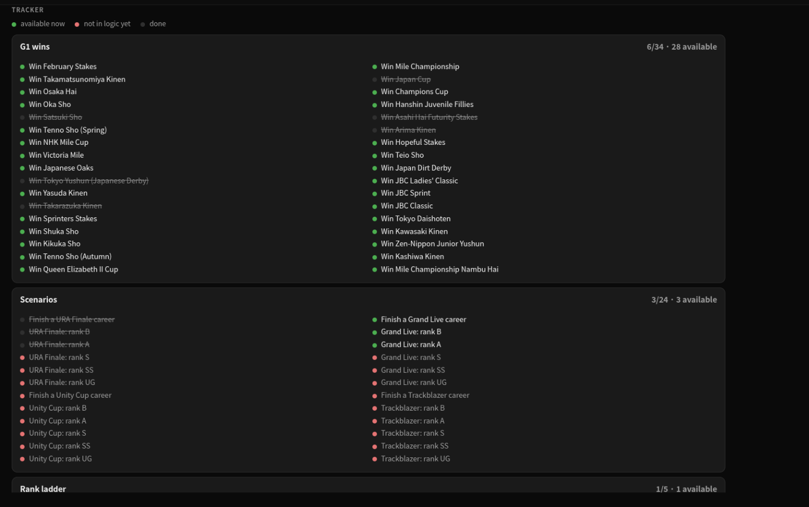
