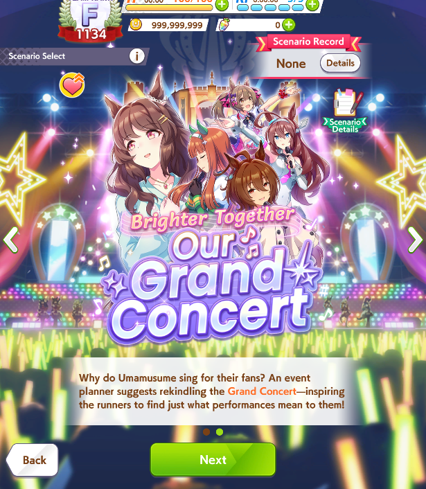
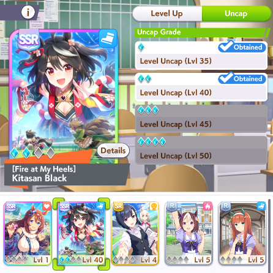
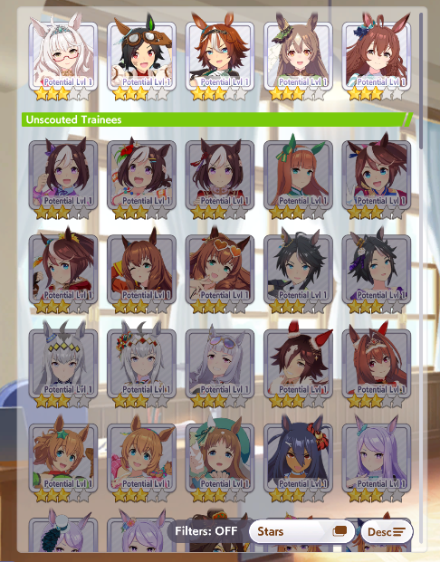
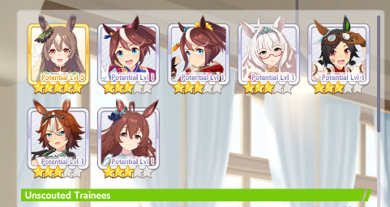

# Showcase

A seed in progress (v0.9.0), played on a local room.

## In the game

**Only unlocked scenarios can be picked.** This seed has URA Finale (starting
scenario) and Grand Live (received as an item); Unity Cup and Trackblazer stay
hidden until they arrive.

([mp4](media/scenario-select.mp4))

**Each seed starts you with its own random trainees.** Only those, and the
ones you receive as items (here Kitasan Black), can start a career; everyone
else stays unscouted.

**Items arrive as presents.** Trainees and support cards land in the gift box,
marked with who sent them.

| Trainee, with her outfit | SSR support card |
|---|---|
|  |  |

**Rainbow Uncap Crystals limit-break the SSR of your choice** (Enhance > Support
Cards > Limit Break), one level each, up to four. Here Kitasan Black after two.

**A Trainee Awakening takes a random trainee you own to 5 stars and potential 5.** Before and after, on the trainee select:

| Before | After |
|---|---|
|  |  |

